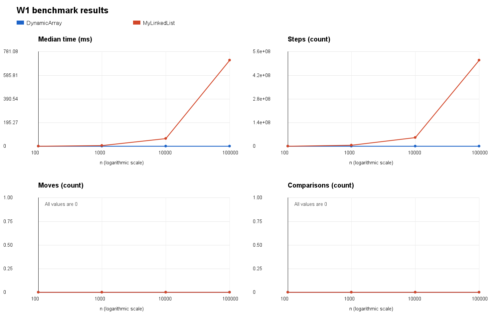
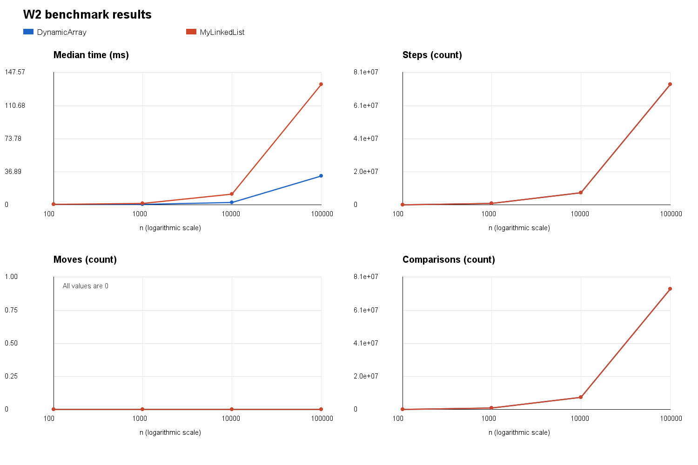
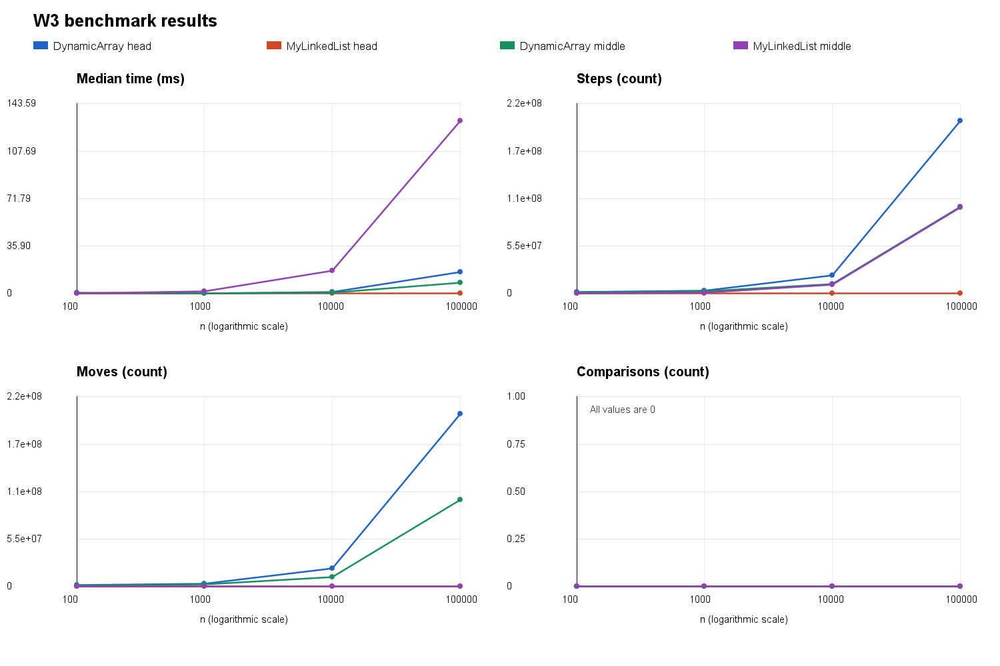
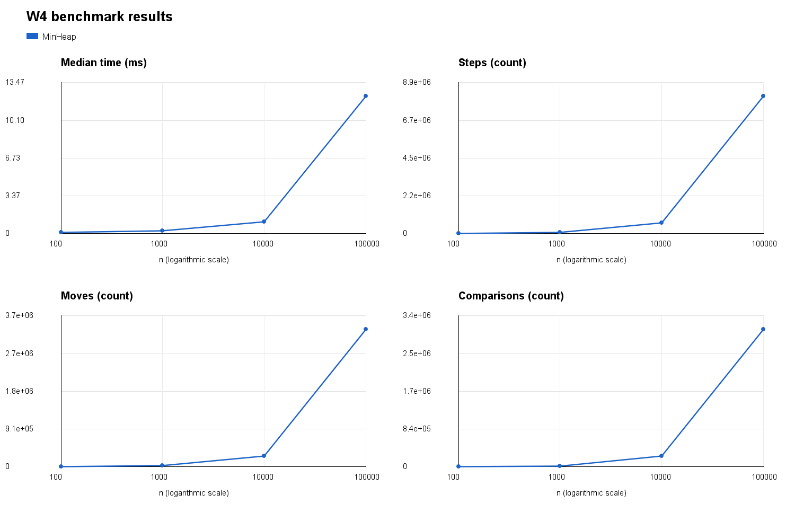

# Assignment 2 Data Structures

Student: Farkhod Sapayev
Group: SE-2525

## 1. Implementation and Measurement Method

This project implements DynamicArray, MyLinkedList and MinHeap
from scratch. DynamicArray and MinHeap store primitive int values
in arrays. MyLinkedList is a singly linked list with head and tail
references. No standard collection is used inside these structures.

DynamicArray doubles its capacity when full. MyLinkedList keeps a
tail reference for constant-time append. MinHeap uses bubble-up
after insertion and bubble-down after removing the minimum.

The benchmark uses Random(42) and sizes 100, 1000, 10000 and 100000.
Each case has two discarded warm-up runs and five measured runs.
The median time is saved together with the counters from that run.
Each repetition starts with a fresh structure and identical data.

For W1–W3, initial filling and query generation are outside the
timed region. W4 includes both insertion and extraction. Its output
array is allocated before timing, and sorted order is checked
after timing. W3 uses a fixed middle index equal to the initial n/2.

Counters are updated inside the structure methods:

- Steps count array-cell reads or following a next-node reference.
- Moves count relocation of existing array elements or updates
  to stored list references, including head and tail.
- Comparisons count comparisons between element values.

Initial placement of a new array value is not counted as a move.
Loop bounds and index checks are not element comparisons.
Local reference assignments are not stored-link updates.
Following a next reference to null is counted as a step.

These counters describe the implemented operations, not CPU
instructions. Timing includes instrumentation overhead.

## 2. Complexity Analysis

Let n be the current number of elements and i a valid index.
Average bounds for indexed list operations assume a uniformly
distributed valid index. Search averages assume absent queries or
a uniformly distributed first matching position with constant
probability. Heap averages depend on the input distribution, so
upper and lower bounds are given instead of an unsupported tight
average bound.

Auxiliary space below means temporary storage used by one call,
excluding the structure's existing storage.

| Structure and operation | Best | Average | Worst | Auxiliary space | Justification |
|---|---|---|---|---|---|
| DynamicArray add(x) | Θ(1) | Θ(1) amortized over appends | Θ(n) | Θ(1), or Θ(n) on growth | Normal append is constant; doubling copies n elements. |
| DynamicArray add(i,x) | Θ(1) | Θ(n) | Θ(n) | Θ(1), or Θ(n) on growth | Shifts n-i elements; growth may also copy n elements. |
| DynamicArray remove(i) | Θ(1) | Θ(n) | Θ(n) | Θ(1) | Shifts n-i-1 elements; removing the last needs no shift. |
| DynamicArray get(i) | Θ(1) | Θ(1) | Θ(1) | Θ(1) | Reads one array cell directly. |
| DynamicArray contains(x) | Θ(1) | Θ(n) | Θ(n) | Θ(1) | Scans until a match or the end. |
| MyLinkedList add(x) | Θ(1) | Θ(1) | Θ(1) | Θ(1) | Uses the stored tail reference. |
| MyLinkedList add(i,x) | Θ(1) | Θ(n) | Θ(n) | Θ(1) | Head and append are constant; interior insertion traverses to the predecessor. |
| MyLinkedList remove(i) | Θ(1) | Θ(n) | Θ(n) | Θ(1) | Head removal is constant; other positions require traversal. |
| MyLinkedList get(i) | Θ(1) | Θ(n) | Θ(n) | Θ(1) | Traverses i links, giving Θ(i+1) time. |
| MyLinkedList contains(x) | Θ(1) | Θ(n) | Θ(n) | Θ(1) | Compares values while following next references. |
| MinHeap insert(x) | Θ(1) | Ω(1), O(log n) amortized | Θ(n) with growth | Θ(1), or Θ(n) on growth | Bubble-up is O(log n); a resizing call copies n elements. |
| MinHeap peekMin() | Θ(1) | Θ(1) | Θ(1) | Θ(1) | Reads the root without traversal. |
| MinHeap extractMin() | Θ(1) | Ω(1), O(log n) | Θ(log n) | Θ(1) | Bubble-down may stop immediately or reach the lowest level. |

Without resizing, the worst-case time of heap insertion is
Θ(log n). Across a sequence of insertions, resizing contributes
O(1) amortized per insertion, so insertion has an amortized
O(log n) upper bound.

For all structures, size() and getMetrics() take Θ(1) time and
Θ(1) auxiliary space. MinHeap.isValidHeap() has best-case Θ(1)
and worst-case Θ(n) time, with Θ(1) auxiliary space; its average
depends on where a violation occurs. It is used for validation,
not inside the timed workload.

All three structures use Θ(n) total storage. The list additionally
stores a next reference and object overhead per node. The array
implementations may have unused capacity. No byte-level memory
measurement was performed.

## 3. Loop Invariant Proofs

### 3.1 DynamicArray contains(value)

Invariant:
Before iteration i, 0 <= i <= size, and none of the elements
at indices 0 through i-1 equals value.

Initialization:
Initially i = 0. The checked prefix is empty, so the invariant
holds.

Maintenance:
The loop compares data[i] with value. If they are equal, returning
true is correct. Otherwise, the checked element does not match.
After incrementing i, the entire enlarged prefix contains no
matching value, so the invariant is preserved.

Termination:
If the loop finishes normally, i = size. The invariant says that
no stored element equals value, so returning false is correct.
The loop terminates because i increases toward the fixed size.

Conclusion:
The method returns true only after finding a matching stored
element. It returns false only after checking every stored element.

### 3.2 DynamicArray remove(index)

Let A be the original array contents, N the original size, and
k the valid removal index. Before shifting, removed = A[k].

Invariant:
Before iteration i, k <= i <= N-1. For every j in [k, i),
data[j] = A[j+1]. For every j in [i, N), data[j] = A[j].
Elements before k are unchanged, and removed remains A[k].

Initialization:
Initially i = k. The shifted interval [k, i) is empty, and all
original elements are unchanged. The invariant holds.

Maintenance:
The assignment data[i] = data[i+1] reads A[i+1], because the
unprocessed suffix is unchanged. It places the correct successor
at position i. After incrementing i, the shifted interval grows
by one, and the remaining suffix is still unchanged.

Termination:
The loop stops at i = N-1. All positions k through N-2 now contain
their original successors. Positions before k are unchanged.
Decreasing size to N-1 excludes the unused final cell.
The loop terminates because i increases toward N-1.

Conclusion:
The operation removes exactly A[k], preserves the order of the
remaining elements, and returns the removed value. For removal
of the last element, the loop is skipped and decreasing size alone
produces the correct result.

## 4. Benchmark Results and Plots

Each figure contains median time, steps, moves and comparisons.
The horizontal axis uses a logarithmic scale. W3 includes both
head and middle variants.

### W1 Random Access

For 100000 elements, DynamicArray completed 10000 reads in
0.230600 ms with 10000 steps. MyLinkedList took 710.070700 ms
with 504930938 steps. Array steps remain constant across sizes,
while list steps grow approximately in proportion to n.

### W2 Search

For 100000 elements, DynamicArray took 31.946300 ms and
MyLinkedList took 134.152300 ms. Both performed 73835543 element
comparisons. Array steps were 73835543; list steps were 73835043.
The difference of 500 occurs because each successful list search
returns before following the next reference.

### W3 Insert and Remove

At n = 100000, head operations took 16.228600 ms for DynamicArray
and 0.006600 ms for MyLinkedList. The array made 200999000 moves,
while the list made 3000 reference updates and 1000 steps.

Middle operations took 8.258800 ms for DynamicArray and
130.536300 ms for MyLinkedList. The array made 100999000 moves.
The list made only 3000 reference updates but required
100000000 traversal steps to locate the positions.

### W4 Priority Processing

| n | Median time in ms | Steps | Moves | Comparisons |
|---|---:|---:|---:|---:|
| 100 | 0.073400 | 3020 | 1267 | 1035 |
| 1000 | 0.235800 | 47421 | 19463 | 17226 |
| 10000 | 1.021800 | 639622 | 259325 | 239329 |
| 100000 | 12.241200 | 8122713 | 3320189 | 3059125 |

Every W4 run checked that extracted values were in non-decreasing
order. The increasing operation counts are consistent with the
O(n log n) upper bound for inserting and extracting n elements.

## 5. Discussion

1. DynamicArray supports constant-time indexed access because
   an index directly identifies the required array cell.
2. MyLinkedList must follow references from the head, explaining
   its rapidly increasing W1 traversal counts.
3. At n = 100000, array random access was approximately 3079 times
   faster in this measurement.
4. Contiguous primitive values provide spatial locality because
   a CPU cache line can contain several neighbouring elements.
5. Sequential array iteration therefore tends to benefit from
   cached neighbouring values, although iteration was not measured
   as a separate workload here.
6. List traversal uses dependent pointer reads, which can limit
   prefetching and expose memory-access latency.
7. Node objects also require headers, references and alignment,
   increasing memory overhead compared with primitive arrays.
8. Node allocation and garbage collection can affect performance,
   although their individual costs were not measured here.
9. W2 used identical comparison counts, yet the array was about
   4.2 times faster at the largest size.
10. This result is consistent with locality and pointer-chasing
    effects, but the counters alone do not prove their contribution.
11. MyLinkedList is a good choice for frequent head insertion and
    removal because these operations do not traverse the list.
12. Indexed middle modification remains expensive because locating
    the predecessor requires linear traversal.
13. DynamicArray was faster for middle modification despite many
    shifts, showing that contiguous work can outperform traversal.
14. MinHeap is suitable for repeatedly processing the smallest
    priority while maintaining efficient insertion and extraction.
15. Small timings and non-monotonic results should be interpreted
    cautiously because two warm-up runs may not fully stabilize
    JIT compilation, and scheduling and instrumentation add noise.

## 6. Validation

The JUnit 5 tests cover empty structures, one element, duplicates,
negative values, first and last indices, and invalid indices.
Random list operations are compared with ArrayList.
Random heap operations are compared with PriorityQueue.

Heap validity is checked after every insertion and extraction in
the heap tests. A separate test verifies non-decreasing output and
exercises repeated array growth. Standard collections appear only
in tests, not inside the implemented data structures.